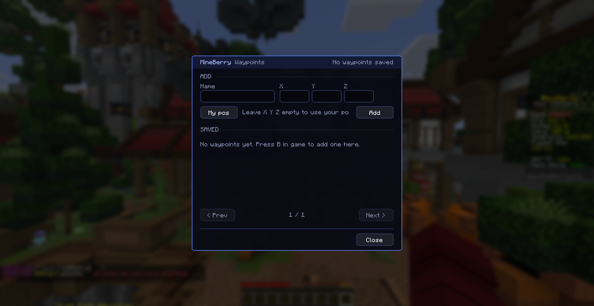
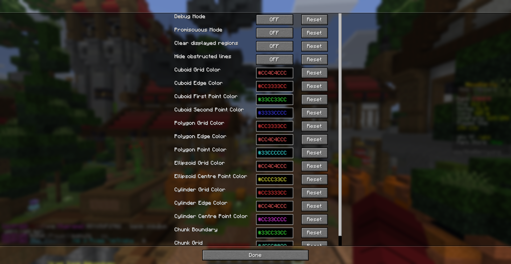

# MineBerry - Essentials

**The all-in-one control center for MineBerry and MinePeak.**
Chat shortcuts, safety tools, evidence reports, waypoints and a coordinate converter, all in one clean dashboard.

> Built for the **MineBerry** and **MinePeak** servers. Some features depend on the commands and chat messages those servers use, so they may not behave the same elsewhere.

## Screenshots

**Control Center** (Midnight and Rose themes)

| Midnight | Rose |
|---|---|
|  |  |

**Waypoints and WorldEditCUI settings**

| Waypoints | WorldEditCUI settings |
|---|---|
|  |  |

**Evidence folders**

---

## Quick Start

1. Install the mod (see [Installation](#installation)).
2. Join MineBerry or MinePeak.
3. Press **Right Control** to open the Control Center.
4. Switch on the modules you want. Everything is optional.

---

## Features

### Control Center
One panel with a switch for every module.
- Built-in keybind reminders, coordinate converter and evidence export
- Four themes: **Rose**, **Aurora**, **Ember** and **Midnight**
- Smooth fade in/out animations
- Optional auto-close when you take damage or PvP danger is detected

### Clan Chat and Admin Chat
Switch your normal chat into a channel with one key.
- `J` toggles Clan Chat (`/cc <message>`)
- `K` toggles Admin Chat (`/ac <message>`)
- An on-screen badge shows which chat is active
- The two channels are mutually exclusive, so you can never mix them up
- Commands are configurable in the config file

### Spawn Escape
Get out of trouble instantly.
- Press **Right Alt** to send `/spawn`
- **Pit guard:** after a sudden large teleport, the mod detects whether you were dropped into a tight pit and escapes automatically
- Ordinary caves and corners will not trigger it

### TP Danger Escape
Protection against `/tpahere` traps.
- After you accept an incoming `/tpahere`, a nearby player lining up to hit you triggers an automatic `/spawn`
- It only arms briefly after an accepted request, so it never interferes with normal play
- Has its own separate toggle

### Evidence Recorder and Abuse Alert
Everything you need for a staff report, captured automatically.
- If the server announces PvP mode after you accept a `/tpahere`, a red alert appears: **POSSIBLE TP KILL / RG ABUSE DETECTED**
- Press `-` to confirm (screenshots and report are saved immediately) or `=` to skip
- Screenshots and `log.txt` are saved automatically
- Each incident is bundled into a **report zip** containing the screenshots, an evidence log and `HOW_TO_REPORT.txt`, ready to attach to a staff ticket
- The panel's **Export** button rebuilds the latest report at any time
- The chat line it listens for is editable via `pvpModePattern`

### Waypoints
- Waypoints are drawn as outlined boxes with a tall beam, **visible through walls**
- A HUD list shows an arrow and the distance to your nearest waypoints
- `B` adds a waypoint at your feet, `N` opens the waypoint list
- Add by name and X/Y/Z, show, hide or delete from the list
- Waypoints are saved per dimension

### Overworld / Nether Converter
Enter X/Z and convert with one click (÷8 or ×8).

### WorldEdit CUI Built In
- The full [WorldEditCUI](https://github.com/EngineHub/WorldEditCUI) is included, so you **do not need a separate mod**
- Toggle the selection display from the panel, with a Settings button for colours and more
- Key binds are under *Options > Controls > WorldEditCUI*

---

## Default Keybinds

| Action | Key |
|---|---|
| Open Control Center | `Right Control` |
| Spawn Escape (`/spawn`) | `Right Alt` |
| Toggle Clan Chat | `J` |
| Toggle Admin Chat | `K` |
| Show / Hide HUD | `Y` |
| Add Waypoint Here | `B` |
| Open Waypoint List | `N` |
| Abuse Alert: Confirm / Skip | `-` / `=` |

All keys can be rebound under *Options > Controls > Key Binds*.

---

## Installation

1. Install [Fabric Loader](https://fabricmc.net/use/) 0.20.1 or newer for Minecraft 26.2.
2. Download [Fabric API](https://modrinth.com/mod/fabric-api) and make sure you are running Java 25 or newer.
3. Put both Fabric API and **MineBerry - Essentials** into your `mods` folder.
4. Launch the game and join the server.

*Mod Menu* is supported if you want quick access to the settings.

### Requirements

| Requirement | Version |
|---|---|
| Minecraft | 26.2 |
| Fabric Loader | 0.20.1 or newer |
| Fabric API | Required |
| Java | 25 or newer |
| Mod Menu | Optional |

> **Do not install the standalone WorldEditCUI mod alongside this one.** It is already built in and the two will conflict.

---

## Configuration

Settings are stored in `config/mineberry_essentials.json`. You can change:

- Chat commands
- The spawn command
- The theme
- The PvP detection pattern
- Your waypoints

---

## FAQ

**Does it work on other servers?**
The general tools (waypoints, converter, WorldEditCUI, themes) work anywhere. Features that react to server commands or chat messages are designed for MineBerry and MinePeak and may not trigger elsewhere.

**Where are my evidence reports saved?**
Screenshots, `log.txt` and the report zip are saved automatically inside your game's `screenshots` folder, in the `testimony`, `reports` and `tpaheres` subfolders. Use the **Export** button in the Control Center to rebuild the latest report.

**A key does not work or clashes with another mod.**
Rebind it under *Options > Controls > Key Binds*.

**The game crashes or WorldEdit selections look broken.**
Make sure the standalone WorldEditCUI mod is not installed.

---

## Support and Feedback

Questions, bug reports or ideas? Join our [Discord](https://discord.gg/ApRvuNsX3j).

## Credits and License

Made by **Agio12 (aerys_ex_)** and **Nice_EX (nice_ex.)**.
Includes [WorldEditCUI](https://github.com/EngineHub/WorldEditCUI) (EPL-2.0).
MineBerry - Essentials is licensed under the **MIT License**.
