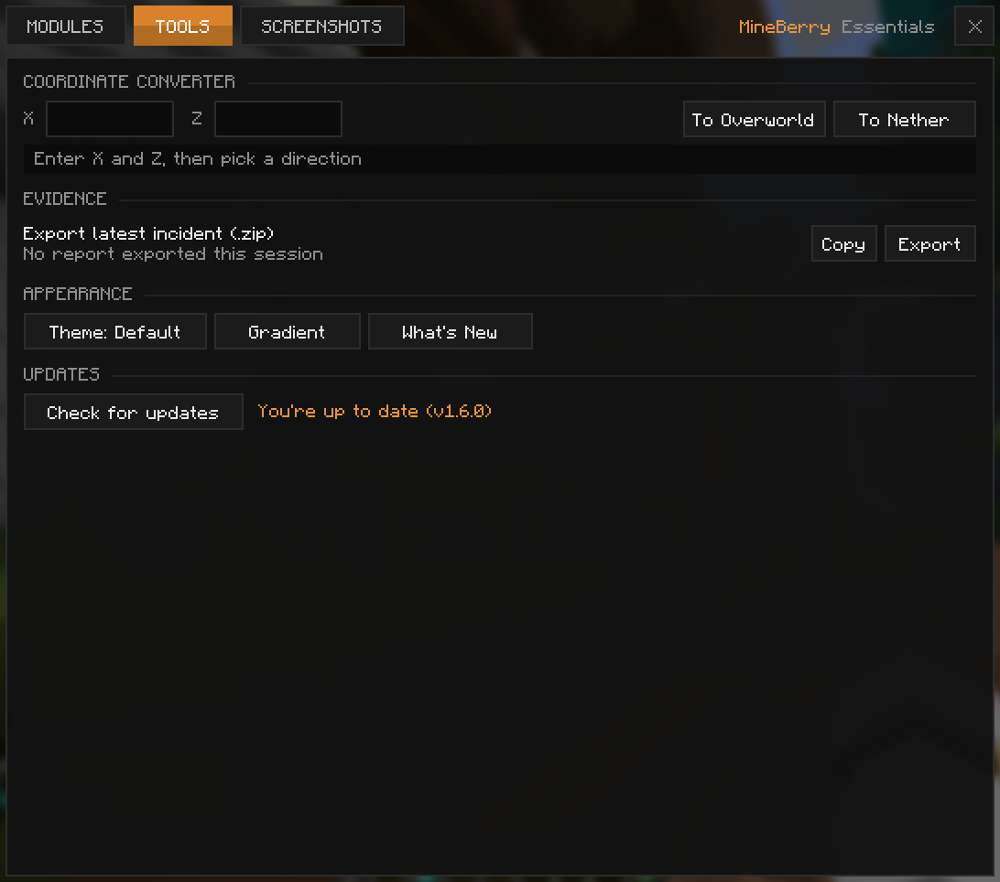
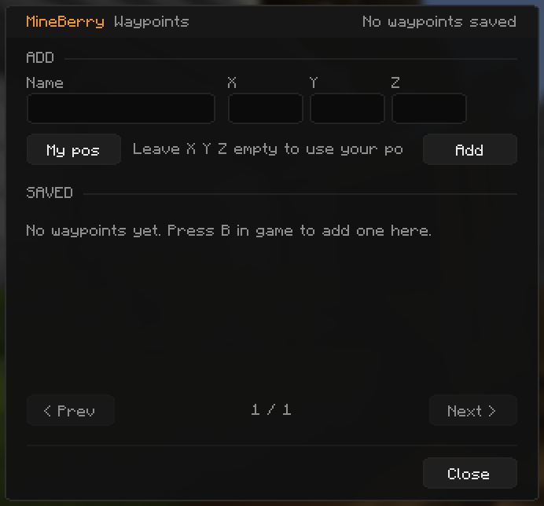
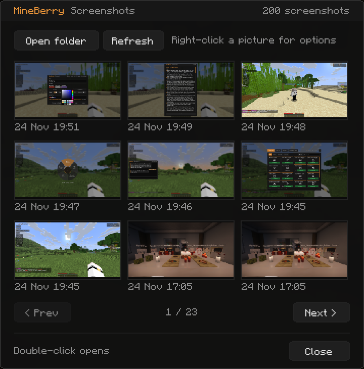
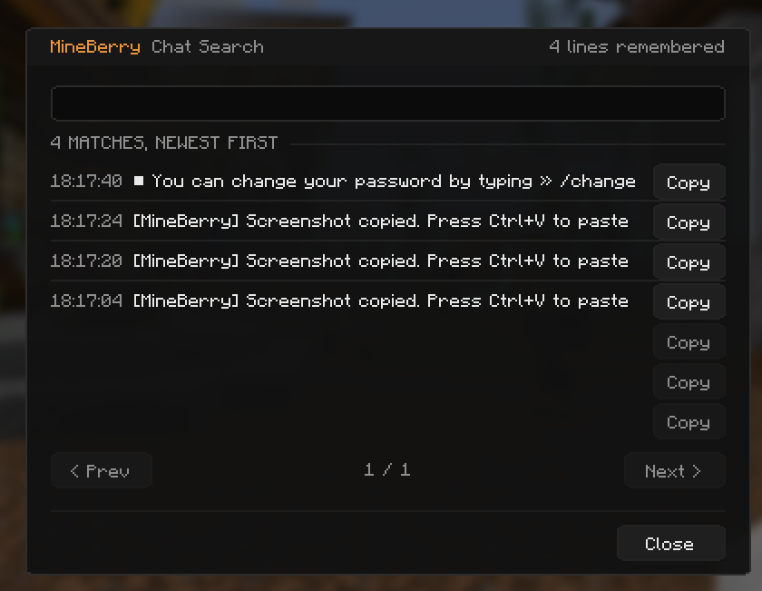
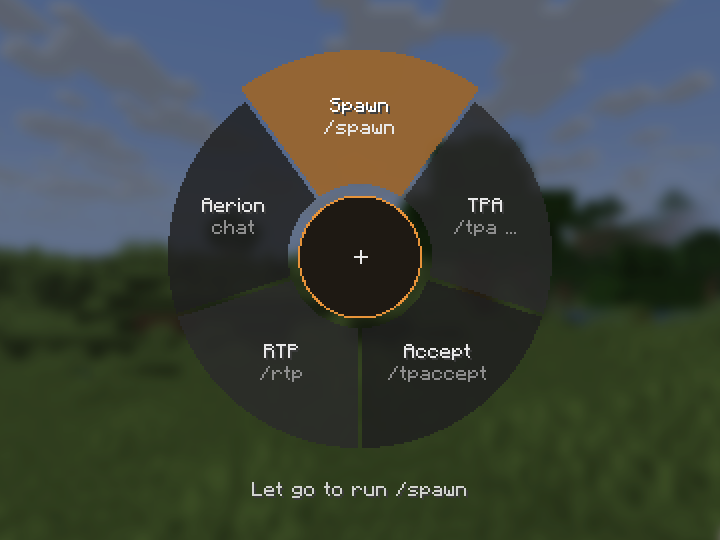
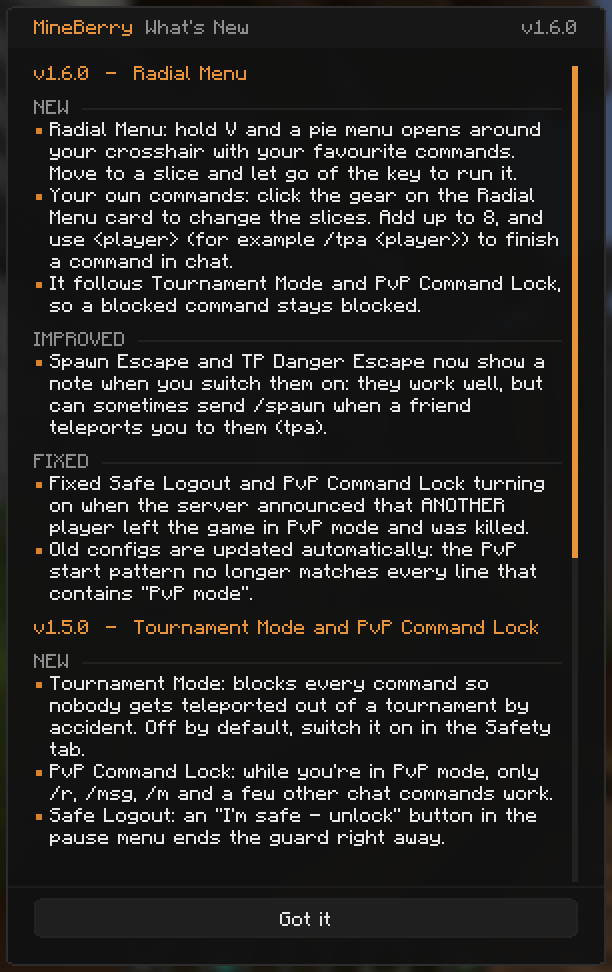

# MineBerry - Essentials

**An essential Fabric mod for MineBerry and MinePeak.**
Chat shortcuts, safety tools, a tournament mode, evidence reports, waypoints, a gradient generator and a coordinate converter, all in one clean dashboard.

You need Minecraft: Java Edition with [Fabric](https://fabricmc.net/use/) installed.

<a href="#installation">Install guide</a> ·
<a href="https://modrinth.com/mod/mineberryessentials">Modrinth</a> ·
<a href="https://discord.gg/ApRvuNsX3j">Discord</a>

  

> Built for the **MineBerry** and **MinePeak** servers. Some features depend on the commands and chat messages those servers use, so they may not behave the same elsewhere.

## What's New in 1.7.3

- **Send Guard:** a new card in the **Safety** tab. `/suicide` and any message with a risky word are **not sent the first time**. Send the exact same thing again within 5 seconds to confirm (press `Up`, then `Enter`). It also covers Clan, Admin and Party chat, private messages and the radial menu. Both lists are in the config file (see [Send Guard](#send-guard))
- **`/rtp` in the radial menu:** a fourth slice. Hold `V`, flick towards **RTP** and let go
- **"Copied to clipboard" popup:** after you take a screenshot with `F2`, a small box appears in the top right for a couple of seconds, so you know the image is ready to paste with `Ctrl+V`. If the image can't be copied, a yellow **Copy failed** box and a chat line tell you the file path was copied instead
- **Fixed a crash in the screenshot gallery:** the game could crash when you deleted a screenshot. It no longer does
- **Fewer failed copies:** if the clipboard is busy with another app, the mod now waits a moment and tries once more

## Screenshots

**Control Center**

| Modules | Tools |
|---|---|
|  |  |

**Gradient Generator and Waypoints**

| Gradient Generator | Waypoints |
|---|---|
|  |  |

**Screenshots and Chat Search**

| Screenshots | Chat Search |
|---|---|
|  |  |

**Radial Menu**

**What's New popup**

**MineBerry Client (HUD)**

---

## Quick Start

1. Install the mod (see [Installation](#installation)).
2. Start the game and click **I Agree** in the Terms of Use window (see [Terms of Use](#terms-of-use)). The mod does nothing until you do.
3. Join MineBerry or MinePeak.
4. Press **Right Control** to open the Control Center.
5. Switch on the modules you want. Everything is optional.

---

## Features

### Control Center
One panel with a card for every module.
- **Modules tab:** cards in a grid, each with an icon and an **Enabled / Disabled** button. Enabled cards get an orange line on top
- **Category tabs:** All, Chat, Safety and Tools
- **Search box** to find a module by name, and a **Reset** button to clear the category and search
- **Hover** a card to see what it does
- **Settings gear** on cards that have settings (Waypoints, Safe Logout, Screenshot, Chat Search)
- Scrollbar and mouse wheel scrolling when there are more modules than fit on screen
- **Screenshots tab:** opens your screenshot list (see [Screenshot](#screenshot))
- **Tools tab:** coordinate converter, evidence export, **Theme**, **Gradient** and **Update** buttons (GitHub and Modrinth). A small orange dot on the tab shows when an update is available
- **Close on danger** and **Chat timestamps** are regular cards in the grid
- Themes: the default **dark grey with orange**, plus **Aurora**, **Ember** and **Midnight**
- Adapts to your window size and GUI scale
- Smooth fade in/out animations
- Optional auto-close when you take damage or PvP danger is detected
- The status boxes on the right side of the screen (Tournament Mode, Safe Logout, chat badges and so on) stack under each other and under the HUD boxes, so they never overlap

### MineBerry Client (HUD)
A separate menu for the on-screen HUD. Press **Right Shift** to open it.
- **Mods tab:** HUD modules shown as cards with an icon, a position and an **Enabled** button. Included modules: **FPS**, **Ping**, **Coordinates**, **Sprint Status**, **Clock**, **Keystrokes / CPS**, **Armor Status**, **Potion Effects**, **Compass**, **Biome / Time**, the **Scoreboard** and the **Watermark**
- Filter the list with **All**, **New** and **HUD**, or use the search box
- **Keystrokes / CPS:** W, A, S, D, both mouse buttons and Space light up while held, with the clicks per second of each mouse button
- **Armor Status:** your armor as item icons with the durability left (green, yellow, red). A held tool or bow is shown too
- **Potion Effects:** every visible effect with its colour, level and time left. The time turns red under 10 seconds
- **Compass:** a scrolling N / NE / E strip with your exact heading and world axis, like `N (-Z) 0°`. With the **Waypoints** module on, your waypoints of the current dimension show as coloured markers under the strip (dimmed at the edge when they are out of view), and looking at one shows its name and distance
- **Biome / Time:** the biome you are in and, in the overworld, the in-game time and Day / Dusk / Night / Dawn
- **Watermark:** a small *MineBerry Essentials* label with no box, top left by default. **On by default**, switch it off or move it like any other module
- The five new modules (Keystrokes / CPS, Armor Status, Potion Effects, Compass, Biome / Time) are **off by default**. Turn them on from their cards
- **Scoreboard:** the sidebar scoreboard the server shows on the right. It has no corner to pick, only the **Enabled** switch (turn it off to hide it) and a size
- Use the `<` `>` buttons or the mouse wheel to change page
- **Profiles:** keep several HUD setups and switch between them, or use **Save as new profile**. Free positions are saved in the profile too. Press the **x** next to a profile to delete it (the last one can't be deleted)
- **Edit HUD Layout** shows every box where it really is:
  - **Drag** a box anywhere. It snaps to the screen edges, the centre and other boxes, and guide lines show what it lines up with
  - **Scroll the mouse wheel** over a box to resize it in 10% steps (50% to 250%). The size shows next to its name while you hover it
  - **Right-click** a box to put it back in the automatic stack at normal size, or press **Reset all**
  - The **Scoreboard** row at the bottom hides or shows the scoreboard and sets its size. The real scoreboard is visible behind the dim layer, so you see the change live
  - Overlapping boxes get a **red outline**
  - A box stays attached to the corner nearest to where you drop it, so it keeps its place when the window or GUI scale changes
- **Settings** and **Waypoints** tabs are also in this menu
- Show or hide the whole HUD with `Y` (rebindable). A reminder is always shown in the menu header and in the **Settings** tab

### Gradient Generator
Make colorful chat text without hand-writing color codes. Open it from the **Gradient** button in the **Tools** tab.
- Type your text (up to 64 characters) and pick **2 to 6 colors**, by typing a hex code (`#RRGGBB`) or with the color picker
- **Color picker:** click the bar under a color box. Drag in the square for saturation and brightness, drag the slider for hue, or click a quick color. The `?` button picks a random color. `Esc` or a click outside closes it
- **Live preview** shows the text colored letter by letter, exactly as it will look
- Six built-in presets to cycle through: **MineBerry**, **Sunset**, **Ocean**, **Mint**, **Fire** and **Rainbow**
- Add or remove color stops with the **+ Color** and **- Color** buttons
- Text styles: **Bold**, **Italic**, **Underline** and **Strikethrough**
- Four output formats, cycled with the **Format** button:
  - `&#RRGGBB`
  - `<#RRGGBB>`
  - `&x&R&R&G&G&B&B`
  - MiniMessage
- A counter shows the length of the result against the 256 character chat limit, and warns you when it is too long
- **Copy** puts the result on your clipboard, ready to paste into chat
- Your colors, format and styles are remembered between sessions

> Which format works depends on the server. Try the formats until one shows colors in chat.

### Update Checker
Know when there is a new version without checking GitHub yourself.
- Checks the latest [GitHub release](https://github.com/aerys-ex/mineberry-essentials/releases) when the game starts
- Press **Check for updates** in the Tools tab to check any time. It shows "Checking...", then "You're up to date" or the new version, and "Couldn't reach GitHub. Try again" if the check failed
- If a newer version exists, you get a popup on the title screen with **GitHub**, **Modrinth** and **Later** buttons. It shows once every time you start the game, until you update
- Tick **Don't remind me about vX** in the popup to stop it for that version. A newer version still notifies you, and you can always check by hand in the Tools tab
- If the answer arrives after you already joined a world, you get one chat message with **[GitHub]** and **[Modrinth]** links instead
- The Tools tab also has **GitHub** and **Modrinth** buttons next to the new version
- Nothing is downloaded or installed automatically, you only get links
- Turn it off any time with `"checkForUpdates": false` in the config file

### What's New Popup
See what changed after you update the mod.
- After you update, a popup shows the changes the first time you start the game on the new version
- It shows only once per version
- Read the notes again any time with the **What's New** button in the Tools tab
- It does not appear on a fresh install, since nothing is new yet
- Turn it off with `"showChangelog": false` in the config file

### Clan, Admin and Party Chat
Switch your normal chat into a channel with one key.
- `J` toggles Clan Chat (`/cc <message>`)
- `K` toggles Admin Chat (`/ac <message>`)
- `X` toggles Party Chat (`/pc <message>`), made for mini games
- A badge on screen shows which chat is active (green for Clan, red for Admin, blue for Party)
- Only one chat mode can be active at a time, so you can never mix them up
- Commands you type yourself (starting with `/`) are never touched
- All three commands are configurable in the config file

### Chat Extras
- **Mention highlight and sound:** when someone says your name, it is shown in bold gold and a sound plays
- Add extra words that count as a mention with `mentionNames` in the config
- **Timestamps:** optional `[HH:mm]` before chat lines, switched with the **Chat timestamps** card in the panel
- Highlight and timestamps apply to messages the server sends as system messages, which is what most chat plugins use

### Quick Reply
Reply to private messages faster. This is its own module with its own card in the Chat category, so you can switch it on or off without touching Chat Extras.
- Press `R` to open chat with `/r ` already typed
- On by default, and your existing `R` keybind carries over
- Rebind it under *Options > Controls > Key Binds*

### Chat Search
Find something you saw in chat.
- Press `F8` to open the search
- Type a word, a player name or coordinates. Results update as you type, newest first
- A line must contain **every word** you type, in any order, ignoring case
- **Copy** puts the full line on your clipboard, handy for coordinates
- Remembers the last 3000 chat lines **in memory only**. Nothing is saved to disk, and it is cleared when you leave a server
- It only sees chat received after the game started, not older messages
- Open it from the gear on the Chat Search card too, and rebind the key under *Options > Controls > Key Binds*

### Radial Menu
Run common commands without typing. Great for showcase videos too.
- **Hold `V`** and a pie menu appears around your crosshair. **Move the mouse towards a slice and let go of the key** to run it
- The slice is picked by direction, so a quick flick is enough. Let go in the middle, or press `Esc`, to cancel
- Slices: `/spawn`, `/tpa <player>`, `/tpaccept` and `/rtp`. They are fixed and can't be changed
- **`/tpa`:** chat opens with `/tpa ` already typed, so you only add the name
- It uses your selected theme, and it never pauses singleplayer
- It works with the safety modules: **Tournament Mode** and **PvP Command Lock** block radial commands like any other command, with a chat line saying what was blocked
- Rebind the key under *Options > Controls > Key Binds*

### Safe Logout
Don't quit in the middle of a fight by accident.
- Follows the server's PvP mode messages: you are guarded from *"You've entered PvP mode!"* until *"You're out of PvP mode!"*. The mod does not count time itself. It also ends if you die or disconnect
- Two modes, set with `safeLogoutMode`:
  - `warn` (default): the first try is refused, a second click quits
  - `block`: quitting is blocked until the server says you are out of PvP mode
- A red **IN PVP MODE** box on the HUD tells you whether quitting is blocked or needs a second click
- The pause menu **Disconnect** button and **Alt+F4** are guarded
- The chat lines are editable via `pvpModePattern` (start) and `combatEndPattern` (end)
- **Only the server counts:** lines typed by players (`<Steve> ...`, `Steve: ...`) and announcements about other players (left the game, was killed, combat logging) never start or end the guard
- The gear on the Safe Logout card switches between the two modes
- **Failsafe:** if the server's end message never arrives (lag, or a missed line), the guard lets go by itself after 180 seconds. Change it with `pvpFailsafeSeconds`
- **"I'm safe - unlock":** while you are guarded, the pause menu shows this button under Disconnect. One click ends the guard immediately
- The server's end message is also read when it comes in the action bar

### PvP Command Lock
Stops commands from teleporting you out of a fight.
- While the server has you in PvP mode, only a few commands work: `/r`, `/reply`, `/msg`, `/m`, `/w`, `/tell` and your clan chat command (`/cc` by default)
- Every other command is blocked until the server says *"You're out of PvP mode!"*, and you get a chat line saying what was blocked
- It follows the same server messages as Safe Logout, ignores player chat and announcements about other players, and works even if Safe Logout is switched off
- It lets go by itself if the end message is missed (see `pvpFailsafeSeconds`), and the **I'm safe - unlock** button in the pause menu ends it at once
- Change the allowed commands with `pvpAllowedCommands` in the config file
- Only on servers, never in singleplayer

### Tournament Mode
Switch it on before a tournament and no command can be sent at all.
- One card in the **Safety** tab. It is **off by default** and stays on until you switch it off
- Blocks commands you type, commands from clickable chat messages and the ones the mod sends itself (Clan / Admin / Party chat). Normal chat messages still work
- A red **TOURNAMENT MODE** box on the HUD reminds you it is on, and a chat line tells you which command was blocked
- Let specific commands through with `tournamentAllowedCommands` in the config file (empty by default)

### Send Guard
Some things you only want to send on purpose.
- One card in the **Safety** tab, **on by default**
- The first time you send a guarded command (`/suicide` by default) or a message that contains a guarded word, **nothing is sent** and a chat line tells you. Send the **exact same thing again within 5 seconds** (press `Up`, then `Enter`) and it goes through. A third send has to be confirmed again
- The word list is a short default list of slurs that get players muted or banned. Words only count as **whole words**, in any case, with an optional plural `s` or `z`. A longer word that merely starts with one of them is left alone
- It works in normal chat, in Clan / Admin / Party chat mode, for `/msg` and `/r`, and for radial menu commands
- **Tournament Mode** and **PvP Command Lock** come first: a command they block is blocked, not asked about
- Change it in the config file: `guardedCommands` (no slash), `guardedWords` and `guardConfirmSeconds` (2 to 30, default 5). Empty a list to guard nothing of that kind, or switch the whole card off

### Tournament HUD
See which of your friends are still alive, and what they say, while tournament chat flies by.
- One card in the **Tools** tab, **off by default**. Press its gear button to add friends by username (up to 30) or remove them
- A box on the HUD lists each friend who is in the match with a status: **alive**, **dead (in-game)**, **dead (left)** or **left**. Alive friends come first, with an **Alive 3/5** counter on top. Under each name you see that friend's last 3 chat messages in full (long ones wrap). Newer messages are brighter, older ones dimmer, and each one fades out by itself after a few seconds
- Dead is detected from the server's death and elimination lines (never from player chat), from the *left the game while in PvP mode and was killed* line, and from a friend switching to spectator mode. Left comes from the player list
- Statuses start fresh when you join a server, when the server says a round, match or game started, and when you press **Reset statuses** in the friends screen
- Move or hide the box in the HUD menu (**Tournament Players**, bottom right by default). It only reads what you already receive and sends nothing
- Change how long messages stay with `tournamentMessageSeconds` and the round start line with `tournamentStartPattern` (empty turns the automatic reset off) in the config file

### Evidence Recorder and Abuse Alert
Everything you need for a staff report, captured automatically.
- If the server announces PvP mode after you accept a `/tpahere`, a red alert appears: **POSSIBLE TP KILL / RG ABUSE DETECTED**
- Press `-` to confirm (screenshots and report are saved immediately) or `=` to skip
- Screenshots and `log.txt` are saved automatically
- Every log line includes the **time** and your **coordinates and dimension**
- When you confirm abuse (or a kill is recorded) the **reported player's name is copied** to your clipboard
- The **Copy** button copies the incident summary as text, ready to paste into a staff ticket
- Each incident is bundled into a **report zip** containing the screenshots, an evidence log and `HOW_TO_REPORT.txt`, ready to attach to a staff ticket
- The **Export** button in the Tools tab rebuilds the latest report at any time
- The chat line it listens for is editable via `pvpModePattern`. Player chat and announcements about other players do not trigger the alert

### Screenshot
Take a screenshot and paste it straight into Discord.
- Press `F2` (the normal Minecraft screenshot key) to take a screenshot. Minecraft saves it in `screenshots/` as always, and the mod **also copies it to your clipboard as an image**, so `Ctrl+V` pastes it. Nothing is taken twice
- A small **Copied to clipboard** box pops up in the top right for a couple of seconds when it worked. If the image can't be copied, you get a yellow **Copy failed** box and a chat line, and the file path is copied instead. The popup follows the HUD hide key (`Y`)
- If the clipboard is busy with another app, the copy is tried a second time before it gives up
- Want a second key? Bind **Extra screenshot key** under *Options > Controls > Key Binds*. It saves to `screenshots/mineberry` and copies too. It is unbound by default
- The **Screenshots** tab (or the gear on the Screenshot card) opens the gallery: a grid of thumbnails of your screenshots, newest first, including the normal `F2` ones. **Right-click** a picture to **Copy image**, **Open**, **Show folder** or **Delete** (it asks you to click twice). Double-click opens a picture, and the mouse wheel changes page
- **Open folder** and **Refresh** buttons sit at the top of the gallery
- The copy uses your system's tools: PowerShell on Windows, `osascript` on macOS, and `wl-copy` or `xclip` on Linux (install one of them)

### Waypoints
- Waypoints are drawn as outlined boxes with a tall beam, **visible through walls**
- A HUD list shows an arrow and the distance to your nearest waypoints
- `B` adds a waypoint at your feet, `N` opens the waypoint list
- Add by name and X/Y/Z, show, hide or delete from the list
- Waypoints are saved per dimension

### Overworld / Nether Converter
Enter X/Z and convert with one click (÷8 or ×8). Find it in the **Tools** tab.

### Terms of Use

The first time you start the game with the mod, a window asks you to agree to a short note. It says, in short:

- The mod is free and community-made, provided "as is"
- By clicking **I Agree** you accept that the mod developers are not held accountable for anything that goes wrong while you use it
- Your settings stay on your computer. The only thing the mod contacts is GitHub, to check for a new version (can be turned off in the config)

**I Agree** switches the mod on. **I Disagree** closes the window and the mod stays off: no module, key, HUD box or update check works. Whenever you press one of the mod's keys, or use **Configure** in Mod Menu, the window opens again so you can change your mind. Esc counts as **I Disagree**.

---

## Default Keybinds

| Action | Key |
|---|---|
| Open Control Center | `Right Control` |
| Open MineBerry Client (HUD) | `Right Shift` |
| Toggle Clan Chat | `J` |
| Toggle Admin Chat | `K` |
| Toggle Party Chat | `X` |
| Quick Reply (`/r`) | `R` |
| Radial Menu (hold, release on a slice) | `V` |
| Show / Hide HUD | `Y` |
| Screenshot (copy to clipboard) | `F2` (the normal screenshot key) |
| Extra screenshot key (optional) | not bound |
| Search Chat | `F8` |
| Add Waypoint Here | `B` |
| Open Waypoint List | `N` |
| Abuse Alert: Confirm / Skip | `-` / `=` |

All keys can be rebound under *Options > Controls > Key Binds*. The Gradient Generator is opened from the Tools tab in the Control Center.

---

## Installation

1. Install [Fabric Loader](https://fabricmc.net/use/) 0.20.1 or newer for Minecraft 26.2.
2. Download [Fabric API](https://modrinth.com/mod/fabric-api) and make sure you are running Java 25 or newer.
3. Put both Fabric API and **MineBerry - Essentials** into your `mods` folder.
4. Launch the game and join the server.

*Mod Menu* is supported if you want quick access to the settings.

### Requirements

| Requirement | Version |
|---|---|
| Minecraft | 26.2 |
| Fabric Loader | 0.20.1 or newer |
| Fabric API | Required |
| Java | 25 or newer |
| Mod Menu | Optional |

---

## Configuration

Settings are stored in `config/mineberry_essentials.json`. You can change:

- Chat commands (Clan, Admin and Party)
- Extra mention names, mention sound and chat timestamps
- Whether the reported player's name is copied automatically (`autoCopyReportedName`)
- `termsAcceptedVersion` is set by the game when you click **I Agree**. Set it back to `0` to see the agreement again
- The theme
- Safe Logout: the mode (`safeLogoutMode`: `warn` or `block`), the PvP mode start line (`pvpModePattern`) and the PvP mode end line (`combatEndPattern`). `combatSeconds` is no longer used
- `pvpModePattern` is also used by PvP Command Lock and the Abuse Alert. Since 1.6.0 its default is `entered pvp mode|entered combat|combat mode|combat tag` and it no longer matches every line containing "PvP mode". Old configs that still have the previous default are updated automatically, a custom pattern is kept as it is
- PvP Command Lock: the commands that still work in PvP mode (`pvpAllowedCommands`)
- Tournament Mode: commands that still work while it is on (`tournamentAllowedCommands`, empty by default)
- Send Guard: the commands that need a second send (`guardedCommands`, `suicide` by default), the words that do (`guardedWords`, a short default list of slurs) and how long you have to confirm (`guardConfirmSeconds`, 5 by default)
- Tournament HUD: your friends (`tournamentFriends`, also editable in the friends screen), how long a message stays (`tournamentMessageSeconds`, 15 by default) and the round start line (`tournamentStartPattern`)
- The failsafe time for Safe Logout and PvP Command Lock (`pvpFailsafeSeconds`, 180 by default)
- The What's New popup (`showChangelog`, on by default)
- Update checking (`checkForUpdates`, on by default) and the version you chose **Don't remind me** for (`skippedUpdateVersion`, empty by default)
- Gradient generator colors, format and styles (saved automatically when you use it)
- Your waypoints

---

## FAQ

**A window with "I Agree" and "I Disagree" opens. What is it?**
That is the [Terms of Use](#terms-of-use). It opens the first time you start the game with the mod, and again whenever you try to use a feature before agreeing. Click **I Agree** and the mod works normally.

**I clicked "I Disagree" by mistake.**
Press any of the mod's keys (for example **Right Control**) and the agreement opens again. Click **I Agree**.

**Does it work on other servers?**
The general tools (waypoints, converter, gradient generator, themes) work anywhere. Features that react to server commands or chat messages are designed for MineBerry and MinePeak and may not trigger elsewhere.

**Where are my evidence reports saved?**
Screenshots, `log.txt` and the report zip are saved automatically inside your game's `screenshots` folder, in the `testimony`, `reports` and `tpaheres` subfolders. Use the **Export** button in the Tools tab to rebuild the latest report.

**Where did the Gradient, Theme and Export buttons go?**
They moved to the **Tools** tab at the top of the Control Center.

**Can I turn off Quick Reply (`/r`) without losing mentions and timestamps?**
Yes. Quick Reply is its own module now. Switch off its card and Chat Extras keeps working.

**The gradient shows up as plain text like `&#E65B93M` in chat.**
That server does not understand the selected format. Press **Format** in the generator and try another one.

**My gradient message is too long.**
Chat is limited to 256 characters and every colored letter adds a color code. Use shorter text or fewer colors, or pick a shorter format. The counter turns red when you are over the limit.

**I do not want update notifications.**
Tick **Don't remind me** in the update popup to stop the reminders for that version. To turn the check off for good, set `"checkForUpdates": false` in `config/mineberry_essentials.json`. You can still check by hand with the **Check for updates** button in the Tools tab.

**The update check says "Couldn't reach GitHub".**
You are offline, or GitHub is blocked on your network. Press **Check for updates** again later. You can always look at the [releases page](https://github.com/aerys-ex/mineberry-essentials/releases) yourself.

**I do not want the What's New popup.**
Set `"showChangelog": false` in `config/mineberry_essentials.json`.

**Safe Logout blocks me even though the fight is over.**
It waits for the server's *"You're out of PvP mode!"* message. If your server words it differently, change `combatEndPattern` in `config/mineberry_essentials.json`. Set `safeLogoutMode` to `block` or `warn` to change how it reacts.

**My message or command was not sent and a yellow line says to send it again.**
That is [Send Guard](#send-guard). It holds back `/suicide` and messages with risky words until you send the exact same thing a second time within 5 seconds. Press `Up`, then `Enter`. Change what it guards with `guardedCommands` and `guardedWords` in `config/mineberry_essentials.json`, or switch the card off in the **Safety** tab.

**I pressed F2 and did not see the "Copied to clipboard" box.**
Check that the **Screenshot** module is switched on in the Control Center, that you agreed to the [Terms of Use](#terms-of-use), and that the HUD is not hidden with `Y`. The box appears about a second after the screenshot, once the copy is done. Paste with `Ctrl+V` to check. If you also run another screenshot mod, try switching its screenshot feature off in case the two get in each other's way.

**The screenshot was not copied as an image.**
Your system's copy tool may be missing. On Linux install `xclip` (or `wl-copy` on Wayland). The file path is copied as text instead, and the screenshot is still saved in `screenshots/mineberry`.

**Every command does nothing and says it was blocked.**
Tournament Mode is on. Switch it off from its card in the **Safety** tab of the Control Center, or add the command to `tournamentAllowedCommands` in the config file.

**A command is blocked and I am not in a tournament.**
The server has you in PvP mode, and PvP Command Lock only allows `/r`, `/msg`, `/m` and a few others. It ends when the server says you are out of PvP mode, after 3 minutes at most, or when you press **I'm safe - unlock** in the pause menu.

**Safe Logout or PvP Command Lock turned on and I was not in a fight.**
Update to 1.6.0. Older versions reacted to *"Player X has left the game while in PvP mode"* (about someone else) and to players typing "entered pvp mode" in chat. Now only the server's own messages about you count. If it still happens, check that `pvpModePattern` in `config/mineberry_essentials.json` is not too broad.

**I can't quit the game and the fight is over.**
Press `Esc` and click **I'm safe - unlock**. The guard also lets go by itself after 180 seconds.

**Can I put my own commands in the radial menu?**
Not at the moment. The slices are fixed: `/spawn`, `/tpa`, `/tpaccept` and `/rtp`.

**I release the radial menu key and nothing happens.**
Let go while the mouse points at a slice (it lights up in the accent colour). In the middle circle nothing is picked. If the slice is lit and still nothing happens, Tournament Mode is on or you are in PvP mode, and the command was blocked. A chat line tells you.

**A key does not work or clashes with another mod.**
Rebind it under *Options > Controls > Key Binds*.

---

## Older Versions

Earlier release notes. The newest ones are at the top of this page.

### 1.7.2

- **Screenshot gallery:** the **Screenshots** tab is now a grid of thumbnails. **Right-click** a picture to **Copy image**, **Open**, **Show folder** or **Delete** (it asks you to click twice). Double-click opens a picture, and the mouse wheel changes page
- **F2 copies to the clipboard:** take a screenshot with the normal Minecraft key (`F2`) and the image is also copied to your clipboard, ready to paste into Discord with `Ctrl+V`. Nothing is taken twice
- **Gradient color picker:** click the bar under any color box in the Gradient Generator to open a picker with a saturation / brightness square, a hue slider and quick colors. The `?` button picks a random color. Typing a hex code still works
- **HUD key reminder:** the MineBerry Client menu now always shows the key that hides and shows the whole HUD (`Y` by default), in the header and in the **Settings** tab. It follows the key if you rebind it
- **Changed:** the `F9` screenshot key is now an optional **Extra screenshot key**, unbound by default. If you already use `F9`, it keeps working

### 1.7.1

- **Update popup fixed:** the "new version" popup now really opens on the title screen when a newer version is out, and you get the chat message when you join a world. Before, the update was only found after you opened the Control Center
- **Modrinth link:** the popup, the chat message and the Tools tab now show a **GitHub** and a **Modrinth** button side by side, so you can download from the site you prefer
- **Don't remind me:** the update popup has a checkbox. Tick it and the popup and chat message stay quiet for that version. When a newer version comes out, you get notified again
- **No more overlapping popups:** the update popup waits until the Terms of Use and What's New windows are closed
- **First launch:** the update check starts as soon as you click **I Agree**

### 1.7.0

- **Spawn Escape removed:** the automatic pit guard is gone, so a friend's `/tpa` can no longer send you to `/spawn` by mistake. The radial menu (hold `V`) still has `/spawn` if you want to escape by hand
- **TP Danger Escape removed:** it could not tell friends from enemies, so it sometimes sent `/spawn` when a friend teleported you to them
- **The `U` key and the two escape boxes are gone** from the HUD menu and the Controls screen too
- **Config cleanup:** the saved switches, HUD positions and sizes of both modules, and the `spawnCommand` and `escapeBoxesHidden` options, are no longer used. Old configs are cleaned automatically

### 1.6.4

- **Terms of Use:** the first time you start the game with the mod, a short agreement opens with two buttons, **I Agree** and **I Disagree**. By agreeing you accept that the mod developers are not held accountable for anything that goes wrong (see [Terms of Use](#terms-of-use))
  - If you click **I Disagree**, the mod stays off: no feature, key or HUD works, and nothing is recorded or sent
  - Every time you try to use a feature while the mod is off, the agreement opens again so you can change your mind
  - Players who update from an older version see it once as well. Your choice is saved in the config file

### 1.6.3

- **Resizable HUD:** scroll the mouse wheel over any HUD box in **Edit HUD Layout** to make it bigger or smaller (50% to 250%). Right-click a box to put its position and size back. Sizes are saved in your HUD profiles
- **Scoreboard:** the sidebar scoreboard now has a card in the HUD menu. **Hide** it with the toggle, or resize it with the new button row in Edit HUD Layout
- **Spawn Escape and TP Danger Escape boxes:** their status boxes are now normal HUD boxes. Hide, drag and resize them like the others. The modules keep working while the box is hidden
- **Hide the escape boxes with a key:** press `U` (rebindable) to hide or show the **Spawn Escape** and **TP Danger Escape** boxes. Both modules keep working while the boxes are hidden
- **Delete HUD profiles:** every profile in the HUD menu sidebar has an **x** button now. The last profile can't be deleted
- **Removed the Right Alt spawn key:** Spawn Escape now only has the automatic pit guard. The radial menu (hold `V`) still has `/spawn`

### 1.6.2

- **New website link:** the Website button in Mod Menu now opens the new Modrinth page, [modrinth.com/mod/mineberryessentials](https://modrinth.com/mod/mineberryessentials)
- **New mod description:** *An essential Fabric mod for MineBerry and MinePeak*
- **WorldEditCUI removed:** the mod no longer includes WorldEditCUI

### 1.6.1

- **Tournament HUD:** a box on your screen that follows your friends during a tournament. Add their usernames with the gear button on its card, and you see each friend's last chat messages in full and whether they are **alive**, **dead (in-game)**, **dead (left)** or **left**, with an **Alive 3/5** counter on top (see [Tournament HUD](#tournament-hud))
  - Dead comes from the server's death and elimination lines and from spectator mode, never from player chat
  - Statuses start fresh when a round starts, when you join a server and when you press **Reset statuses**
  - Off by default. Move or hide it in the HUD menu (**Tournament Players**)
- **Edit HUD Layout, drag anywhere:** drag any HUD box where you want it. It snaps to the screen edges, the centre and the other boxes, with guide lines. Right-click a box to put it back in the automatic stack, or press **Reset all**. Boxes that overlap get a red outline (see [MineBerry Client (HUD)](#mineberry-client-hud))
  - A box stays attached to the corner nearest to where you drop it, so your layout survives window and GUI scale changes
  - Positions are saved in your HUD profiles
- **Compass waypoints:** your waypoints show as coloured markers under the Compass strip. Look at one and the Compass shows its name and distance (needs the **Waypoints** module)
- **Watermark:** a small *MineBerry Essentials* label in the top left corner, drawn without a box. On by default, switch it off or move it in the HUD menu
- **Fixed overlapping HUD boxes:** Tournament Mode, Spawn Escape, TP Danger Escape, Safe Logout, the Clan / Admin / Party badge and the waypoint list now stack under the HUD boxes of the top right corner instead of drawing on top of them and of each other. The abuse alert no longer covers the top left boxes
- **Config:** new `tournamentFriends`, `tournamentMessageSeconds` and `tournamentStartPattern` (see [Configuration](#configuration)). The default theme's config id changed from `lunar` to `default`, and old configs are converted automatically

### 1.6.0

- **Radial Menu:** hold `V` and a pie menu opens around your crosshair with quick commands (`/spawn`, `/tpa` and `/tpaccept`). Move to a slice and let go of the key to run it (see [Radial Menu](#radial-menu))
  - `/tpa` opens chat with `/tpa ` already typed, so you only add the player's name
  - Let go in the middle or press `Esc` to cancel
  - It follows your theme, Tournament Mode and PvP Command Lock, so a blocked command stays blocked
- **Heads-up notes:** Spawn Escape and TP Danger Escape now show a note when you switch them on: they work well, but can sometimes send `/spawn` when a friend teleports you to them 
- **Fixed false PvP mode alarms:** the server's line *"Player X has left the game while in PvP mode and was killed"* is about someone else, but it used to switch on Safe Logout and PvP Command Lock for you. Announcements about other players (left the game, was killed, combat logging) are now ignored
- **Chat can't trigger PvP mode anymore:** a player typing "entered pvp mode" (or similar) in chat used to switch on Safe Logout, PvP Command Lock and the abuse alert. Only the server's own messages count now
- **Config:** the default `pvpModePattern` is now `entered pvp mode|entered combat|combat mode|combat tag`. It no longer matches every line that contains "PvP mode". Configs that still have the old default are updated automatically, a pattern you changed yourself is left alone (see [Configuration](#configuration))

### 1.5.0

- **Tournament Mode:** a new switch that blocks every command, so nobody types one by accident and gets sent to another gamemode (see [Tournament Mode](#tournament-mode))
- **PvP Command Lock:** while the server has you in PvP mode, only `/r`, `/reply`, `/msg`, `/m`, `/w`, `/tell` and your clan chat command work (see [PvP Command Lock](#pvp-command-lock))
- **Safe Logout failsafe:** if the server's "out of PvP mode" message is missed, the guard lets go by itself after 3 minutes (`pvpFailsafeSeconds`)
- **"I'm safe - unlock" button** in the pause menu: ends the guard right away (see [Safe Logout](#safe-logout))
- Safe Logout now also reads the "out of PvP mode" message when the server sends it in the action bar

### 1.4.5

- **Screenshot:** press `F9` to take a screenshot and copy it to your clipboard as an image, ready to paste into Discord (see [Screenshot](#screenshot))
- **Screenshots tab:** see your screenshots, copy or open any of them
- **Chat Search:** press `F8` to search the chat you received this session (see [Chat Search](#chat-search))
- **Safe Logout** now follows the server's PvP mode messages instead of a 30 second timer (see [Safe Logout](#safe-logout))
- Fixed Safe Logout re-entering combat right after the server said you were out of PvP mode
- Fixed keybind names in the controls menu

### 1.4.0

- **Five new HUD modules:** **Keystrokes / CPS**, **Armor Status**, **Potion Effects**, **Compass** and **Biome / Time** (see [MineBerry Client (HUD)](#mineberry-client-hud))
- **HUD menu pages:** the Mods tab now has `<` `>` page buttons (or use the mouse wheel) when there are more modules than fit
- **Smarter HUD layout:** when a screen corner is full, the next modules start a second column instead of going off screen
- **Safe Logout:** quitting is guarded for a few seconds after combat, so you can't leave a fight by accident (see [Safe Logout](#safe-logout))
- **What's New popup:** after an update, a popup shows what changed, once (see [What's New Popup](#whats-new-popup))
- Fixes for Minecraft 26.2 (Safe Logout and the pause menu guard)

### 1.3.1

- **Manual update check:** a new **Check for updates** button in the Tools tab, under Updates. It works even if automatic checking is turned off, and you can press it again if a check fails
- **More reliable update checker:** it no longer depends on GitHub's rate-limited API, so it keeps working on shared networks. The API is only a fallback

### 1.3.0

- **Control Center redesign:** a new flat look with an orange accent. Modules are now cards in a grid, each with an icon and an Enabled / Disabled button (see [Control Center](#control-center))
- **Modules and Tools tabs:** the coordinate converter, evidence export, Theme, Gradient and Update buttons now live in the Tools tab
- **Category tabs, search and reset** to find a module fast
- **Quick Reply (`/r`) is now its own module,** separate from Chat Extras (see [Quick Reply](#quick-reply))
- **MineBerry Client (HUD):** a new menu with HUD modules, profiles and a layout editor, opened with **Right Shift** (see [MineBerry Client (HUD)](#mineberry-client-hud))
- New default theme: dark grey with orange
- The Website button in Mod Menu opened the GitHub page (since 1.6.2 it opens the Modrinth page)

---

## Support and Feedback

Questions, bug reports or ideas? Join our [Discord](https://discord.gg/ApRvuNsX3j).

## Credits and License

Made by **Agio12 (ex.aerys)** and **Nice_EX (nice_ex.)**.
MineBerry - Essentials is licensed under the **MIT License**.
