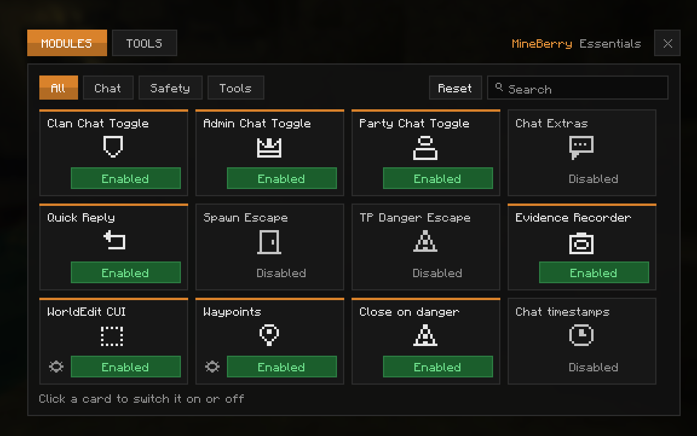
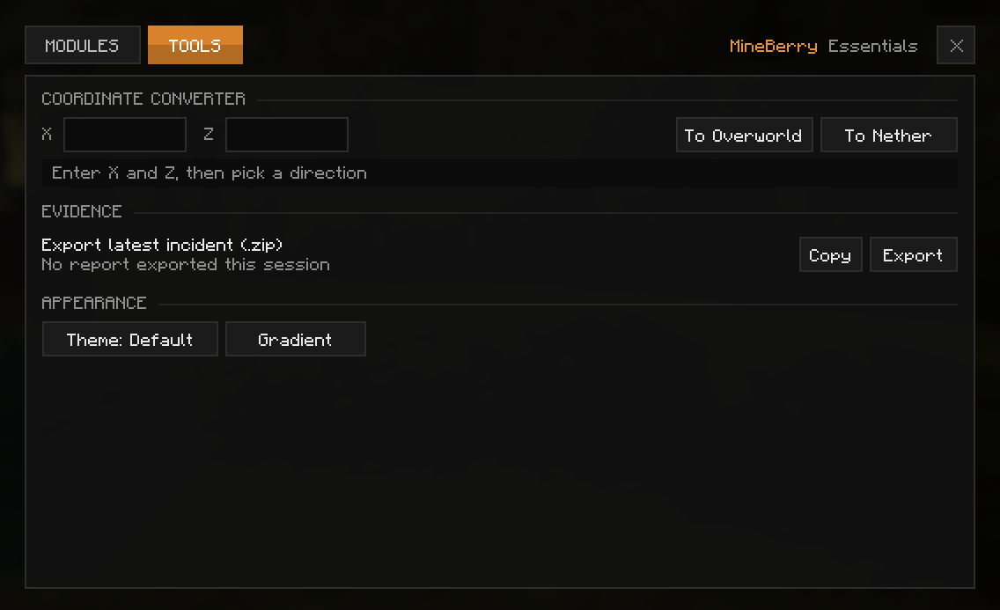
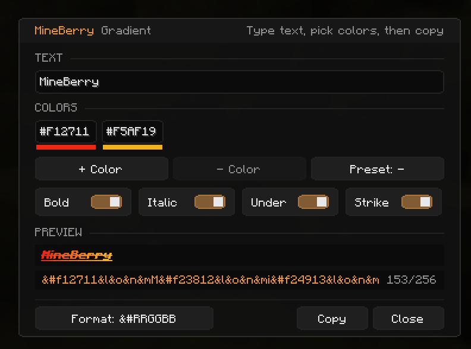
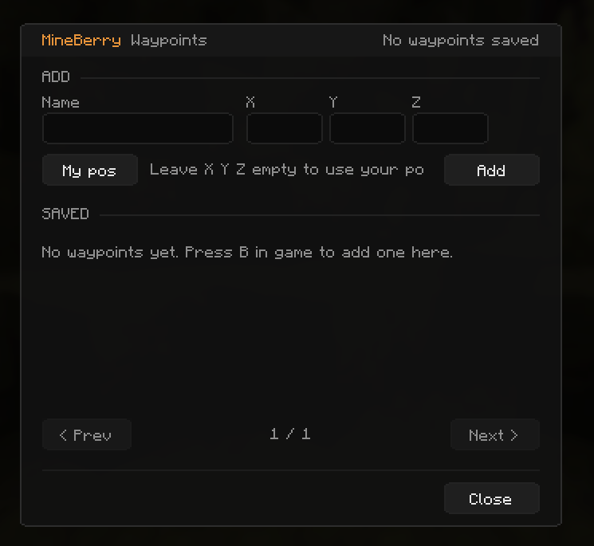
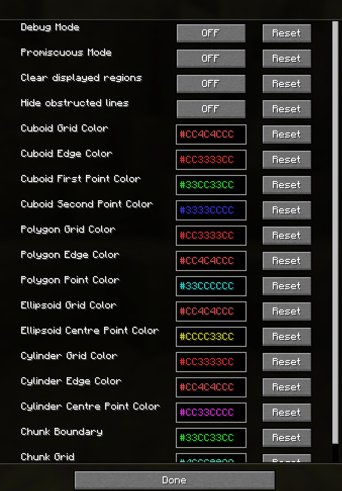

# MineBerry - Essentials

**The all-in-one control center for MineBerry and MinePeak.**
Chat shortcuts, safety tools, evidence reports, waypoints, a gradient generator and a coordinate converter, all in one clean dashboard.

> Built for the **MineBerry** and **MinePeak** servers. Some features depend on the commands and chat messages those servers use, so they may not behave the same elsewhere.

## What's New in 1.3.0

- **Control Center redesign:** a new flat look with an orange accent. Modules are now cards in a grid, each with an icon and an Enabled / Disabled button (see [Control Center](#control-center))
- **Modules and Tools tabs:** the coordinate converter, evidence export, Theme, Gradient and Update buttons now live in the Tools tab
- **Category tabs, search and reset** to find a module fast
- **Quick Reply (`/r`) is now its own module,** separate from Chat Extras (see [Quick Reply](#quick-reply))
- New default theme: dark grey with orange
- The Website button in Mod Menu now opens this GitHub page

## Screenshots

**Control Center**

| Modules | Tools |
|---|---|
|  |  |

**Gradient Generator and Waypoints**

| Gradient Generator | Waypoints |
|---|---|
|  |  |

**WorldEditCUI settings**

---

## Quick Start

1. Install the mod (see [Installation](#installation)).
2. Join MineBerry or MinePeak.
3. Press **Right Control** to open the Control Center.
4. Switch on the modules you want. Everything is optional.

---

## Features

### Control Center
One panel with a card for every module.
- **Modules tab:** cards in a grid, each with an icon and an **Enabled / Disabled** button. Enabled cards get an orange line on top
- **Category tabs:** All, Chat, Safety and Tools
- **Search box** to find a module by name, and a **Reset** button to clear the category and search
- **Hover** a card to see what it does
- **Settings gear** on cards that have settings (Waypoints, WorldEdit CUI)
- Scrollbar and mouse wheel scrolling when there are more modules than fit on screen
- **Tools tab:** coordinate converter, evidence export, **Theme**, **Gradient** and **Update** buttons. A small orange dot on the tab shows when an update is available
- **Close on danger** and **Chat timestamps** are regular cards in the grid
- Themes: the default **dark grey with orange**, plus **Aurora**, **Ember** and **Midnight**
- Adapts to your window size and GUI scale
- Smooth fade in/out animations
- Optional auto-close when you take damage or PvP danger is detected

### Gradient Generator
Make colorful chat text without hand-writing color codes. Open it from the **Gradient** button in the **Tools** tab.
- Type your text (up to 64 characters) and pick **2 to 6 colors** as hex codes (`#RRGGBB`)
- **Live preview** shows the text colored letter by letter, exactly as it will look
- Six built-in presets to cycle through: **MineBerry**, **Sunset**, **Ocean**, **Mint**, **Fire** and **Rainbow**
- Add or remove color stops with the **+ Color** and **- Color** buttons
- Text styles: **Bold**, **Italic**, **Underline** and **Strikethrough**
- Four output formats, cycled with the **Format** button:
  - `&#RRGGBB`
  - `<#RRGGBB>`
  - `&x&R&R&G&G&B&B`
  - MiniMessage
- A counter shows the length of the result against the 256 character chat limit, and warns you when it is too long
- **Copy** puts the result on your clipboard, ready to paste into chat
- Your colors, format and styles are remembered between sessions

> Which format works depends on the server. Try the formats until one shows colors in chat.

### Update Checker
Know when there is a new version without checking GitHub yourself.
- Checks the latest [GitHub release](https://github.com/aerys-ex/mineberry-essentials/releases) when the game starts
- If a newer version exists, you get a popup on the title screen, one chat message with a **[Download]** link when you join a world, and an **Update** button in the Tools tab
- Nothing is downloaded or installed automatically, you only get a link
- Turn it off any time with `"checkForUpdates": false` in the config file

### Clan, Admin and Party Chat
Switch your normal chat into a channel with one key.
- `J` toggles Clan Chat (`/cc <message>`)
- `K` toggles Admin Chat (`/ac <message>`)
- `X` toggles Party Chat (`/pc <message>`), made for mini games
- A badge on screen shows which chat is active (green for Clan, red for Admin, blue for Party)
- Only one chat mode can be active at a time, so you can never mix them up
- Commands you type yourself (starting with `/`) are never touched
- All three commands are configurable in the config file

### Chat Extras
- **Mention highlight and sound:** when someone says your name, it is shown in bold gold and a sound plays
- Add extra words that count as a mention with `mentionNames` in the config
- **Timestamps:** optional `[HH:mm]` before chat lines, switched with the **Chat timestamps** card in the panel
- Highlight and timestamps apply to messages the server sends as system messages, which is what most chat plugins use

### Quick Reply
Reply to private messages faster. This is its own module with its own card in the Chat category, so you can switch it on or off without touching Chat Extras.
- Press `R` to open chat with `/r ` already typed
- On by default, and your existing `R` keybind carries over
- Rebind it under *Options > Controls > Key Binds*

### Spawn Escape
Get out of trouble instantly.
- Press **Right Alt** to send `/spawn`
- **Pit guard:** after a sudden large teleport, the mod detects whether you were dropped into a tight pit and escapes automatically
- Ordinary caves and corners will not trigger it

### TP Danger Escape
Protection against `/tpahere` traps.
- After you accept an incoming `/tpahere`, a nearby player lining up to hit you triggers an automatic `/spawn`
- It only arms briefly after an accepted request, so it never interferes with normal play
- Has its own separate toggle

### Evidence Recorder and Abuse Alert
Everything you need for a staff report, captured automatically.
- If the server announces PvP mode after you accept a `/tpahere`, a red alert appears: **POSSIBLE TP KILL / RG ABUSE DETECTED**
- Press `-` to confirm (screenshots and report are saved immediately) or `=` to skip
- Screenshots and `log.txt` are saved automatically
- Every log line includes the **time** and your **coordinates and dimension**
- When you confirm abuse (or a kill is recorded) the **reported player's name is copied** to your clipboard
- The **Copy** button copies the incident summary as text, ready to paste into a staff ticket
- Each incident is bundled into a **report zip** containing the screenshots, an evidence log and `HOW_TO_REPORT.txt`, ready to attach to a staff ticket
- The **Export** button in the Tools tab rebuilds the latest report at any time
- The chat line it listens for is editable via `pvpModePattern`

### Waypoints
- Waypoints are drawn as outlined boxes with a tall beam, **visible through walls**
- A HUD list shows an arrow and the distance to your nearest waypoints
- `B` adds a waypoint at your feet, `N` opens the waypoint list
- Add by name and X/Y/Z, show, hide or delete from the list
- Waypoints are saved per dimension

### Overworld / Nether Converter
Enter X/Z and convert with one click (÷8 or ×8). Find it in the **Tools** tab.

### WorldEdit CUI Built In
- The full [WorldEditCUI](https://github.com/EngineHub/WorldEditCUI) is included, so you **do not need a separate mod**
- Toggle the selection display from the panel, with a settings gear for colours and more
- Key binds are under *Options > Controls > WorldEditCUI*

---

## Default Keybinds

| Action | Key |
|---|---|
| Open Control Center | `Right Control` |
| Spawn Escape (`/spawn`) | `Right Alt` |
| Toggle Clan Chat | `J` |
| Toggle Admin Chat | `K` |
| Toggle Party Chat | `X` |
| Quick Reply (`/r`) | `R` |
| Show / Hide HUD | `Y` |
| Add Waypoint Here | `B` |
| Open Waypoint List | `N` |
| Abuse Alert: Confirm / Skip | `-` / `=` |

All keys can be rebound under *Options > Controls > Key Binds*. The Gradient Generator is opened from the Tools tab in the Control Center.

---

## Installation

1. Install [Fabric Loader](https://fabricmc.net/use/) 0.20.1 or newer for Minecraft 26.2.
2. Download [Fabric API](https://modrinth.com/mod/fabric-api) and make sure you are running Java 25 or newer.
3. Put both Fabric API and **MineBerry - Essentials** into your `mods` folder.
4. Launch the game and join the server.

*Mod Menu* is supported if you want quick access to the settings.

### Requirements

| Requirement | Version |
|---|---|
| Minecraft | 26.2 |
| Fabric Loader | 0.20.1 or newer |
| Fabric API | Required |
| Java | 25 or newer |
| Mod Menu | Optional |

> **Do not install the standalone WorldEditCUI mod alongside this one.** It is already built in and the two will conflict.

---

## Configuration

Settings are stored in `config/mineberry_essentials.json`. You can change:

- Chat commands (Clan, Admin and Party)
- Extra mention names, mention sound and chat timestamps
- Whether the reported player's name is copied automatically (`autoCopyReportedName`)
- The spawn command
- The theme
- The PvP detection pattern
- Update checking (`checkForUpdates`, on by default)
- Gradient generator colors, format and styles (saved automatically when you use it)
- Your waypoints

---

## FAQ

**Does it work on other servers?**
The general tools (waypoints, converter, gradient generator, WorldEditCUI, themes) work anywhere. Features that react to server commands or chat messages are designed for MineBerry and MinePeak and may not trigger elsewhere.

**Where are my evidence reports saved?**
Screenshots, `log.txt` and the report zip are saved automatically inside your game's `screenshots` folder, in the `testimony`, `reports` and `tpaheres` subfolders. Use the **Export** button in the Tools tab to rebuild the latest report.

**Where did the Gradient, Theme and Export buttons go?**
They moved to the **Tools** tab at the top of the Control Center.

**Can I turn off Quick Reply (`/r`) without losing mentions and timestamps?**
Yes. Quick Reply is its own module now. Switch off its card and Chat Extras keeps working.

**The gradient shows up as plain text like `&#E65B93M` in chat.**
That server does not understand the selected format. Press **Format** in the generator and try another one.

**My gradient message is too long.**
Chat is limited to 256 characters and every colored letter adds a color code. Use shorter text or fewer colors, or pick a shorter format. The counter turns red when you are over the limit.

**I do not want update notifications.**
Set `"checkForUpdates": false` in `config/mineberry_essentials.json`.

**A key does not work or clashes with another mod.**
Rebind it under *Options > Controls > Key Binds*.

**The game crashes or WorldEdit selections look broken.**
Make sure the standalone WorldEditCUI mod is not installed.

---

## Support and Feedback

Questions, bug reports or ideas? Join our [Discord](https://discord.gg/ApRvuNsX3j).

## Credits and License

Made by **Agio12 (ex.aerys)** and **Nice_EX (nice_ex.)**.
Includes [WorldEditCUI](https://github.com/EngineHub/WorldEditCUI) (EPL-2.0).
MineBerry - Essentials is licensed under the **MIT License**.
