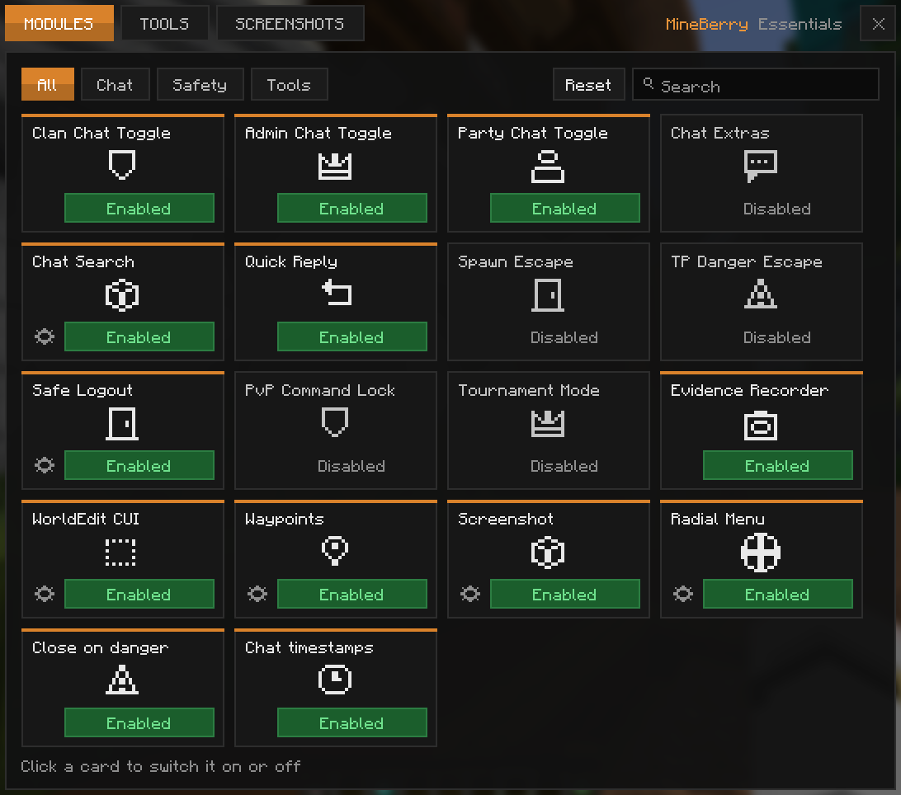
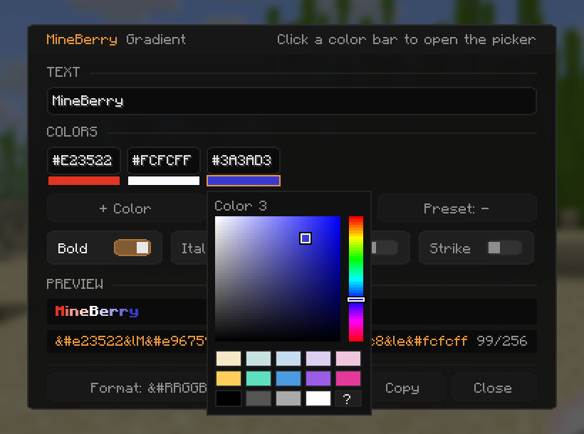
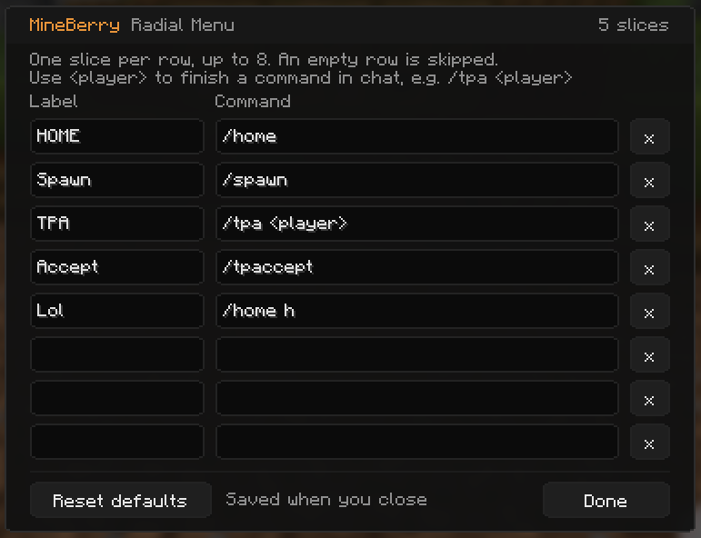
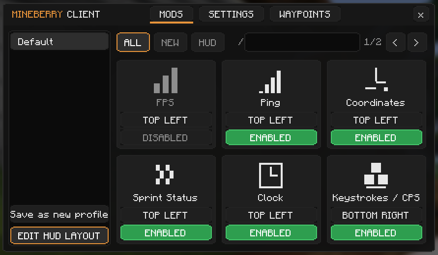

# MineBerry - Essentials

**The all-in-one control center for MineBerry and MinePeak.**
Chat shortcuts, safety tools, a tournament mode, evidence reports, waypoints, a gradient generator and a coordinate converter, all in one clean dashboard.

> Built for the **MineBerry** and **MinePeak** servers. Some features depend on the commands and chat messages those servers use, so they may not behave the same elsewhere.

## What's New in 1.6.0

- **Radial Menu:** hold a key and a pie menu opens around your crosshair with your most-used commands (`/home`, `/spawn`, `/tpa` and more). Move to a slice and let go of the key to run it (see [Radial Menu](#radial-menu))
- **Your own commands:** change the slices with the gear on the Radial Menu card, or in the config file
- It follows Tournament Mode and PvP Command Lock, so a blocked command stays blocked
- **Heads-up notes:** Spawn Escape and TP Danger Escape now show a note when you switch them on: they work well, but can sometimes send `/spawn` when a friend teleports you to them (see [Spawn Escape](#spawn-escape) and [TP Danger Escape](#tp-danger-escape))
- **Fixed false PvP mode alarms:** the server's line *"Player X has left the game while in PvP mode and was killed"* is about someone else, but it used to switch on Safe Logout and PvP Command Lock for you. Announcements about other players (left the game, was killed, combat logging) are now ignored
- The default `pvpModePattern` no longer matches every line that contains "PvP mode". Old configs that still have the old default are updated automatically

## Screenshots

**Control Center**

| Modules | Tools |
|---|---|
|  |  |

**Gradient Generator and Waypoints**

| Gradient Generator | Waypoints |
|---|---|
|  |  |

**Screenshots and Chat Search**

| Screenshots | Chat Search |
|---|---|
|  |  |

**Radial Menu**

| Radial Menu | Editor |
|---|---|
|  |  |

**What's New popup**

**MineBerry Client (HUD)**

---

## Quick Start

1. Install the mod (see [Installation](#installation)).
2. Join MineBerry or MinePeak.
3. Press **Right Control** to open the Control Center.
4. Switch on the modules you want. Everything is optional.

---

## Features

### Control Center
One panel with a card for every module.
- **Modules tab:** cards in a grid, each with an icon and an **Enabled / Disabled** button. Enabled cards get an orange line on top
- **Category tabs:** All, Chat, Safety and Tools
- **Search box** to find a module by name, and a **Reset** button to clear the category and search
- **Hover** a card to see what it does
- **Settings gear** on cards that have settings (Waypoints, Safe Logout, Screenshot, Chat Search, Radial Menu, WorldEdit CUI)
- Scrollbar and mouse wheel scrolling when there are more modules than fit on screen
- **Screenshots tab:** opens your screenshot list (see [Screenshot](#screenshot))
- **Tools tab:** coordinate converter, evidence export, **Theme**, **Gradient** and **Update** buttons. A small orange dot on the tab shows when an update is available
- **Close on danger** and **Chat timestamps** are regular cards in the grid
- Themes: the default **dark grey with orange**, plus **Aurora**, **Ember** and **Midnight**
- Adapts to your window size and GUI scale
- Smooth fade in/out animations
- Optional auto-close when you take damage or PvP danger is detected

### MineBerry Client (HUD)
A separate menu for the on-screen HUD. Press **Right Shift** to open it.
- **Mods tab:** HUD modules shown as cards with an icon, a position and an **Enabled** button. Included modules: **FPS**, **Ping**, **Coordinates**, **Sprint Status**, **Clock**, **Keystrokes / CPS**, **Armor Status**, **Potion Effects**, **Compass** and **Biome / Time**
- Filter the list with **All**, **New** and **HUD**, or use the search box
- **Keystrokes / CPS:** W, A, S, D, both mouse buttons and Space light up while held, with the clicks per second of each mouse button
- **Armor Status:** your armor as item icons with the durability left (green, yellow, red). A held tool or bow is shown too
- **Potion Effects:** every visible effect with its colour, level and time left. The time turns red under 10 seconds
- **Compass:** a scrolling N / NE / E strip with your exact heading and world axis, like `N (-Z) 0°`
- **Biome / Time:** the biome you are in and, in the overworld, the in-game time and Day / Dusk / Night / Dawn
- The five new modules are **off by default**. Turn them on from their cards
- Use the `<` `>` buttons or the mouse wheel to change page
- **Profiles:** keep several HUD setups and switch between them, or use **Save as new profile**
- **Edit HUD Layout** lets you move the modules around on screen
- **Settings** and **Waypoints** tabs are also in this menu
- Show or hide the whole HUD with `Y`

### Gradient Generator
Make colorful chat text without hand-writing color codes. Open it from the **Gradient** button in the **Tools** tab.
- Type your text (up to 64 characters) and pick **2 to 6 colors** as hex codes (`#RRGGBB`)
- **Live preview** shows the text colored letter by letter, exactly as it will look
- Six built-in presets to cycle through: **MineBerry**, **Sunset**, **Ocean**, **Mint**, **Fire** and **Rainbow**
- Add or remove color stops with the **+ Color** and **- Color** buttons
- Text styles: **Bold**, **Italic**, **Underline** and **Strikethrough**
- Four output formats, cycled with the **Format** button:
  - `&#RRGGBB`
  - `<#RRGGBB>`
  - `&x&R&R&G&G&B&B`
  - MiniMessage
- A counter shows the length of the result against the 256 character chat limit, and warns you when it is too long
- **Copy** puts the result on your clipboard, ready to paste into chat
- Your colors, format and styles are remembered between sessions

> Which format works depends on the server. Try the formats until one shows colors in chat.

### Update Checker
Know when there is a new version without checking GitHub yourself.
- Checks the latest [GitHub release](https://github.com/aerys-ex/mineberry-essentials/releases) when the game starts
- Press **Check for updates** in the Tools tab to check any time. It shows "Checking...", then "You're up to date" or the new version, and "Couldn't reach GitHub. Try again" if the check failed
- If a newer version exists, you get a popup on the title screen, one chat message with a **[Download]** link when you join a world, and an **Update** button in the Tools tab
- Nothing is downloaded or installed automatically, you only get a link
- Turn it off any time with `"checkForUpdates": false` in the config file

### What's New Popup
See what changed after you update the mod.
- After you update, a popup shows the changes the first time you start the game on the new version
- It shows only once per version
- Read the notes again any time with the **What's New** button in the Tools tab
- It does not appear on a fresh install, since nothing is new yet
- Turn it off with `"showChangelog": false` in the config file

### Clan, Admin and Party Chat
Switch your normal chat into a channel with one key.
- `J` toggles Clan Chat (`/cc <message>`)
- `K` toggles Admin Chat (`/ac <message>`)
- `X` toggles Party Chat (`/pc <message>`), made for mini games
- A badge on screen shows which chat is active (green for Clan, red for Admin, blue for Party)
- Only one chat mode can be active at a time, so you can never mix them up
- Commands you type yourself (starting with `/`) are never touched
- All three commands are configurable in the config file

### Chat Extras
- **Mention highlight and sound:** when someone says your name, it is shown in bold gold and a sound plays
- Add extra words that count as a mention with `mentionNames` in the config
- **Timestamps:** optional `[HH:mm]` before chat lines, switched with the **Chat timestamps** card in the panel
- Highlight and timestamps apply to messages the server sends as system messages, which is what most chat plugins use

### Quick Reply
Reply to private messages faster. This is its own module with its own card in the Chat category, so you can switch it on or off without touching Chat Extras.
- Press `R` to open chat with `/r ` already typed
- On by default, and your existing `R` keybind carries over
- Rebind it under *Options > Controls > Key Binds*

### Chat Search
Find something you saw in chat.
- Press `F8` to open the search
- Type a word, a player name or coordinates. Results update as you type, newest first
- A line must contain **every word** you type, in any order, ignoring case
- **Copy** puts the full line on your clipboard, handy for coordinates
- Remembers the last 3000 chat lines **in memory only**. Nothing is saved to disk, and it is cleared when you leave a server
- It only sees chat received after the game started, not older messages
- Open it from the gear on the Chat Search card too, and rebind the key under *Options > Controls > Key Binds*

### Radial Menu
Run your favourite commands without typing. Great for showcase videos too.
- **Hold `V`** and a pie menu appears around your crosshair. **Move the mouse towards a slice and let go of the key** to run it
- The slice is picked by direction, so a quick flick is enough. Let go in the middle, or press `Esc`, to cancel
- Default slices: `/home`, `/spawn`, `/tpa <player>` and `/tpaccept`
- **Use your own commands:** click the gear on the **Radial Menu** card (Control Center) to open the editor. Every row is one slice with a label and a command. Add up to 8, clear a row to remove it, **Reset defaults** brings the original ones back. Changes are saved when you close the editor
- **Commands that need an argument:** put a placeholder in it, like `/tpa <player>`. Chat then opens with `/tpa ` already typed, so you only add the name
- It uses your selected theme, and it never pauses singleplayer
- It works with the safety modules: **Tournament Mode** and **PvP Command Lock** block radial commands like any other command, with a chat line saying what was blocked
- Rebind the key under *Options > Controls > Key Binds*

### Spawn Escape
Get out of trouble instantly.
- Press **Right Alt** to send `/spawn`
- **Pit guard:** after a sudden large teleport, the mod detects whether you were dropped into a tight pit and escapes automatically
- Ordinary caves and corners will not trigger it
- **Note:** it works well, but the pit guard can sometimes send `/spawn` when a **friend teleports you to them** (tpa). The Control Center shows this note when you switch the module on. Switch the module off if you are about to do a lot of friendly teleporting. The **Right Alt** key keeps working either way

### Safe Logout
Don't quit in the middle of a fight by accident.
- Follows the server's PvP mode messages: you are guarded from *"You've entered PvP mode!"* until *"You're out of PvP mode!"*. The mod does not count time itself. It also ends if you die or disconnect
- Two modes, set with `safeLogoutMode`:
  - `warn` (default): the first try is refused, a second click quits
  - `block`: quitting is blocked until the server says you are out of PvP mode
- A red **IN PVP MODE** box on the HUD tells you whether quitting is blocked or needs a second click
- The pause menu **Disconnect** button and **Alt+F4** are guarded
- The chat lines are editable via `pvpModePattern` (start) and `combatEndPattern` (end)
- The gear on the Safe Logout card switches between the two modes
- **Failsafe:** if the server's end message never arrives (lag, or a missed line), the guard lets go by itself after 180 seconds. Change it with `pvpFailsafeSeconds`
- **"I'm safe - unlock":** while you are guarded, the pause menu shows this button under Disconnect. One click ends the guard immediately
- The server's end message is also read when it comes in the action bar

### PvP Command Lock
Stops commands from teleporting you out of a fight.
- While the server has you in PvP mode, only a few commands work: `/r`, `/reply`, `/msg`, `/m`, `/w`, `/tell` and your clan chat command (`/cc` by default)
- Every other command is blocked until the server says *"You're out of PvP mode!"*, and you get a chat line saying what was blocked
- It follows the same server messages as Safe Logout and works even if Safe Logout is switched off
- It lets go by itself if the end message is missed (see `pvpFailsafeSeconds`), and the **I'm safe - unlock** button in the pause menu ends it at once
- Change the allowed commands with `pvpAllowedCommands` in the config file
- Only on servers, never in singleplayer

### Tournament Mode
Switch it on before a tournament and no command can be sent at all.
- One card in the **Safety** tab. It is **off by default** and stays on until you switch it off
- Blocks commands you type, commands from clickable chat messages and the ones the mod sends itself (Spawn Escape, TP Danger Escape, Clan / Admin / Party chat). Normal chat messages still work
- A red **TOURNAMENT MODE** box on the HUD reminds you it is on, and a chat line tells you which command was blocked
- Let specific commands through with `tournamentAllowedCommands` in the config file (empty by default)

### TP Danger Escape
Protection against `/tpahere` traps.
- After you accept an incoming `/tpahere`, a nearby player lining up to hit you triggers an automatic `/spawn`
- It only arms briefly after an accepted request, so it never interferes with normal play
- Has its own separate toggle
- **Note:** it works well, but it can't tell friends from enemies, so it can sometimes send `/spawn` when a **friend teleports you to them** and stands close to you. The Control Center shows this note when you switch the module on. Switch it off when you are teleporting with friends

### Evidence Recorder and Abuse Alert
Everything you need for a staff report, captured automatically.
- If the server announces PvP mode after you accept a `/tpahere`, a red alert appears: **POSSIBLE TP KILL / RG ABUSE DETECTED**
- Press `-` to confirm (screenshots and report are saved immediately) or `=` to skip
- Screenshots and `log.txt` are saved automatically
- Every log line includes the **time** and your **coordinates and dimension**
- When you confirm abuse (or a kill is recorded) the **reported player's name is copied** to your clipboard
- The **Copy** button copies the incident summary as text, ready to paste into a staff ticket
- Each incident is bundled into a **report zip** containing the screenshots, an evidence log and `HOW_TO_REPORT.txt`, ready to attach to a staff ticket
- The **Export** button in the Tools tab rebuilds the latest report at any time
- The chat line it listens for is editable via `pvpModePattern`

### Screenshot
Take a screenshot and paste it straight into Discord.
- Press `F9` to take a screenshot. It is saved in `screenshots/mineberry` **and copied to your clipboard as an image**, so `Ctrl+V` pastes it
- A chat line confirms the copy. If the image can't be copied, the file path is copied instead
- The **Screenshots** tab (or the gear on the Screenshot card) lists your screenshots, newest first, including normal `F2` ones
- **Copy** puts any screenshot on your clipboard, **Open** shows it in your image viewer. There are also **Open folder** and **Refresh** buttons
- The copy uses your system's tools: PowerShell on Windows, `osascript` on macOS, and `wl-copy` or `xclip` on Linux (install one of them)

### Waypoints
- Waypoints are drawn as outlined boxes with a tall beam, **visible through walls**
- A HUD list shows an arrow and the distance to your nearest waypoints
- `B` adds a waypoint at your feet, `N` opens the waypoint list
- Add by name and X/Y/Z, show, hide or delete from the list
- Waypoints are saved per dimension

### Overworld / Nether Converter
Enter X/Z and convert with one click (÷8 or ×8). Find it in the **Tools** tab.

### WorldEdit CUI Built In
- The full [WorldEditCUI](https://github.com/EngineHub/WorldEditCUI) is included, so you **do not need a separate mod**
- Toggle the selection display from the panel, with a settings gear for colours and more
- Key binds are under *Options > Controls > WorldEditCUI*

---

## Default Keybinds

| Action | Key |
|---|---|
| Open Control Center | `Right Control` |
| Open MineBerry Client (HUD) | `Right Shift` |
| Spawn Escape (`/spawn`) | `Right Alt` |
| Toggle Clan Chat | `J` |
| Toggle Admin Chat | `K` |
| Toggle Party Chat | `X` |
| Quick Reply (`/r`) | `R` |
| Radial Menu (hold, release on a slice) | `V` |
| Show / Hide HUD | `Y` |
| Screenshot (copy to clipboard) | `F9` |
| Search Chat | `F8` |
| Add Waypoint Here | `B` |
| Open Waypoint List | `N` |
| Abuse Alert: Confirm / Skip | `-` / `=` |

All keys can be rebound under *Options > Controls > Key Binds*. The Gradient Generator is opened from the Tools tab in the Control Center.

---

## Installation

1. Install [Fabric Loader](https://fabricmc.net/use/) 0.20.1 or newer for Minecraft 26.2.
2. Download [Fabric API](https://modrinth.com/mod/fabric-api) and make sure you are running Java 25 or newer.
3. Put both Fabric API and **MineBerry - Essentials** into your `mods` folder.
4. Launch the game and join the server.

*Mod Menu* is supported if you want quick access to the settings.

### Requirements

| Requirement | Version |
|---|---|
| Minecraft | 26.2 |
| Fabric Loader | 0.20.1 or newer |
| Fabric API | Required |
| Java | 25 or newer |
| Mod Menu | Optional |

> **Do not install the standalone WorldEditCUI mod alongside this one.** It is already built in and the two will conflict.

---

## Configuration

Settings are stored in `config/mineberry_essentials.json`. You can change:

- Chat commands (Clan, Admin and Party)
- Extra mention names, mention sound and chat timestamps
- Whether the reported player's name is copied automatically (`autoCopyReportedName`)
- The spawn command
- The radial menu slices (`radialSlices`: a list of `label` and `command` pairs, up to 8)
- The theme
- The PvP detection pattern
- Safe Logout: the mode (`safeLogoutMode`: `warn` or `block`), the PvP mode start line (`pvpModePattern`) and the PvP mode end line (`combatEndPattern`). `combatSeconds` is no longer used
- PvP Command Lock: the commands that still work in PvP mode (`pvpAllowedCommands`)
- Tournament Mode: commands that still work while it is on (`tournamentAllowedCommands`, empty by default)
- The failsafe time for Safe Logout and PvP Command Lock (`pvpFailsafeSeconds`, 180 by default)
- The What's New popup (`showChangelog`, on by default)
- Update checking (`checkForUpdates`, on by default)
- Gradient generator colors, format and styles (saved automatically when you use it)
- Your waypoints

---

## FAQ

**Does it work on other servers?**
The general tools (waypoints, converter, gradient generator, WorldEditCUI, themes) work anywhere. Features that react to server commands or chat messages are designed for MineBerry and MinePeak and may not trigger elsewhere.

**Where are my evidence reports saved?**
Screenshots, `log.txt` and the report zip are saved automatically inside your game's `screenshots` folder, in the `testimony`, `reports` and `tpaheres` subfolders. Use the **Export** button in the Tools tab to rebuild the latest report.

**Where did the Gradient, Theme and Export buttons go?**
They moved to the **Tools** tab at the top of the Control Center.

**Can I turn off Quick Reply (`/r`) without losing mentions and timestamps?**
Yes. Quick Reply is its own module now. Switch off its card and Chat Extras keeps working.

**The gradient shows up as plain text like `&#E65B93M` in chat.**
That server does not understand the selected format. Press **Format** in the generator and try another one.

**My gradient message is too long.**
Chat is limited to 256 characters and every colored letter adds a color code. Use shorter text or fewer colors, or pick a shorter format. The counter turns red when you are over the limit.

**I do not want update notifications.**
Set `"checkForUpdates": false` in `config/mineberry_essentials.json`. You can still check by hand with the **Check for updates** button in the Tools tab.

**The update check says "Couldn't reach GitHub".**
You are offline, or GitHub is blocked on your network. Press **Check for updates** again later. You can always look at the [releases page](https://github.com/aerys-ex/mineberry-essentials/releases) yourself.

**I do not want the What's New popup.**
Set `"showChangelog": false` in `config/mineberry_essentials.json`.

**Safe Logout blocks me even though the fight is over.**
It waits for the server's *"You're out of PvP mode!"* message. If your server words it differently, change `combatEndPattern` in `config/mineberry_essentials.json`. Set `safeLogoutMode` to `block` or `warn` to change how it reacts.

**The screenshot was not copied as an image.**
Your system's copy tool may be missing. On Linux install `xclip` (or `wl-copy` on Wayland). The file path is copied as text instead, and the screenshot is still saved in `screenshots/mineberry`.

**Every command does nothing and says it was blocked.**
Tournament Mode is on. Switch it off from its card in the **Safety** tab of the Control Center, or add the command to `tournamentAllowedCommands` in the config file.

**A command is blocked and I am not in a tournament.**
The server has you in PvP mode, and PvP Command Lock only allows `/r`, `/msg`, `/m` and a few others. It ends when the server says you are out of PvP mode, after 3 minutes at most, or when you press **I'm safe - unlock** in the pause menu.

**I can't quit the game and the fight is over.**
Press `Esc` and click **I'm safe - unlock**. The guard also lets go by itself after 180 seconds.

**Can I put my own commands in the radial menu?**
Yes. Click the gear on the **Radial Menu** card, type a label and a command per row, and close the editor. You can also edit `radialSlices` in `config/mineberry_essentials.json`. For commands that need a name, write `/tpa <player>` and chat opens with `/tpa ` typed.

**I release the radial menu key and nothing happens.**
Let go while the mouse points at a slice (it lights up in the accent colour). In the middle circle nothing is picked. If the slice is lit and still nothing happens, Tournament Mode is on or you are in PvP mode, and the command was blocked. A chat line tells you.

**Spawn Escape or TP Danger Escape sent me to spawn when a friend teleported me.**
That can happen. Both modules react to teleports and nearby players, and they can't tell a friend from an enemy. Switch the module off in the Control Center while you teleport with friends, and back on afterwards. The **Right Alt** spawn key does not depend on it.

**A key does not work or clashes with another mod.**
Rebind it under *Options > Controls > Key Binds*.

**The game crashes or WorldEdit selections look broken.**
Make sure the standalone WorldEditCUI mod is not installed.

---

## Older Versions

Earlier release notes. The newest ones are at the top of this page.

### 1.5.0

- **Tournament Mode:** a new switch that blocks every command, so nobody types one by accident and gets sent to another gamemode (see [Tournament Mode](#tournament-mode))
- **PvP Command Lock:** while the server has you in PvP mode, only `/r`, `/reply`, `/msg`, `/m`, `/w`, `/tell` and your clan chat command work (see [PvP Command Lock](#pvp-command-lock))
- **Safe Logout failsafe:** if the server's "out of PvP mode" message is missed, the guard lets go by itself after 3 minutes (`pvpFailsafeSeconds`)
- **"I'm safe - unlock" button** in the pause menu: ends the guard right away (see [Safe Logout](#safe-logout))
- Safe Logout now also reads the "out of PvP mode" message when the server sends it in the action bar

### 1.4.5

- **Screenshot:** press `F9` to take a screenshot and copy it to your clipboard as an image, ready to paste into Discord (see [Screenshot](#screenshot))
- **Screenshots tab:** see your screenshots, copy or open any of them
- **Chat Search:** press `F8` to search the chat you received this session (see [Chat Search](#chat-search))
- **Safe Logout** now follows the server's PvP mode messages instead of a 30 second timer (see [Safe Logout](#safe-logout))
- Fixed Safe Logout re-entering combat right after the server said you were out of PvP mode
- Fixed keybind names in the controls menu

### 1.4.0

- **Five new HUD modules:** **Keystrokes / CPS**, **Armor Status**, **Potion Effects**, **Compass** and **Biome / Time** (see [MineBerry Client (HUD)](#mineberry-client-hud))
- **HUD menu pages:** the Mods tab now has `<` `>` page buttons (or use the mouse wheel) when there are more modules than fit
- **Smarter HUD layout:** when a screen corner is full, the next modules start a second column instead of going off screen
- **Safe Logout:** quitting is guarded for a few seconds after combat, so you can't leave a fight by accident (see [Safe Logout](#safe-logout))
- **What's New popup:** after an update, a popup shows what changed, once (see [What's New Popup](#whats-new-popup))
- Fixes for Minecraft 26.2 (Safe Logout and the pause menu guard)

### 1.3.1

- **Manual update check:** a new **Check for updates** button in the Tools tab, under Updates. It works even if automatic checking is turned off, and you can press it again if a check fails
- **More reliable update checker:** it no longer depends on GitHub's rate-limited API, so it keeps working on shared networks. The API is only a fallback

### 1.3.0

- **Control Center redesign:** a new flat look with an orange accent. Modules are now cards in a grid, each with an icon and an Enabled / Disabled button (see [Control Center](#control-center))
- **Modules and Tools tabs:** the coordinate converter, evidence export, Theme, Gradient and Update buttons now live in the Tools tab
- **Category tabs, search and reset** to find a module fast
- **Quick Reply (`/r`) is now its own module,** separate from Chat Extras (see [Quick Reply](#quick-reply))
- **MineBerry Client (HUD):** a new menu with HUD modules, profiles and a layout editor, opened with **Right Shift** (see [MineBerry Client (HUD)](#mineberry-client-hud))
- New default theme: dark grey with orange
- The Website button in Mod Menu now opens this GitHub page

---

## Support and Feedback

Questions, bug reports or ideas? Join our [Discord](https://discord.gg/ApRvuNsX3j).

## Credits and License

Made by **Agio12 (ex.aerys)** and **Nice_EX (nice_ex.)**.
Includes [WorldEditCUI](https://github.com/EngineHub/WorldEditCUI) (EPL-2.0).
MineBerry - Essentials is licensed under the **MIT License**.
